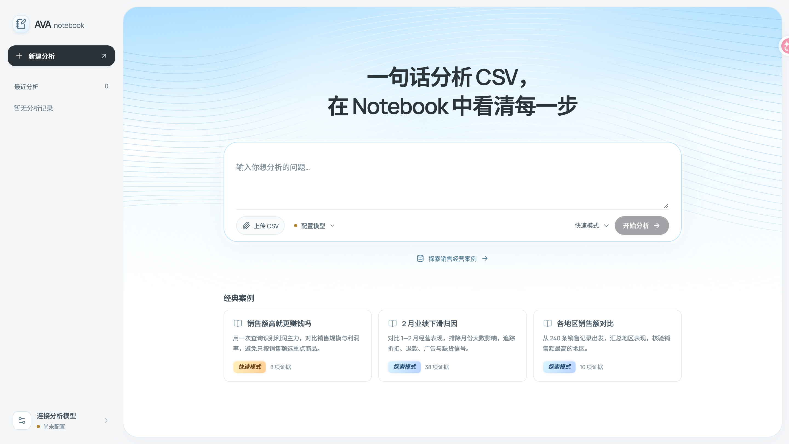

<div align="center">

# AVA Notebook

**用一句话分析 CSV，在 Notebook 中看清每一步。**

基于 [AVA](https://github.com/antvis/AVA) 的自然语言数据分析笔记本

[🚀 在线体验](https://ava-notebook.vercel.app)

</div>



## ✨ 从问题到答案

上传 CSV，配置模型，提出你的问题。选择 **Direct** 快速分析，或用 **Loop** 深入探索。

- 📓 **分析笔记** · 查看分析步骤、SQL、数据、图表和结论
- 🔎 **证据图谱** · 沿着数据源和查询，追溯结论的依据
- 🔒 **数据安全** · CSV 和分析记录保存在浏览器，SQL 在本地执行；记录可导出为 JSON

DuckDB-Wasm 在浏览器中执行 SQL。分析过程中会向你配置的模型服务发送必要的数据上下文，请选择可信的模型服务。

## 🧭 先看看示例

首页提供「销售额高就更赚钱吗」「各地区销售额对比」和「2 月业绩下滑归因」三个案例，打开即可回看分析过程。

| 📓 分析笔记 | 🔎 证据图谱 |
| :---: | :---: |
|  |  |

## 🛠️ 本地运行

需要 Node.js 22.13.0 或更高版本。

```bash
npm ci
npm run dev
```

按终端提示打开本地地址。构建使用 `npm run build`，测试使用 `npm test` 和 `npm run test:browser`。
